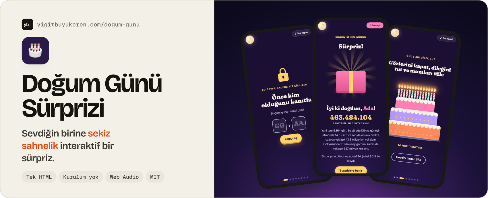
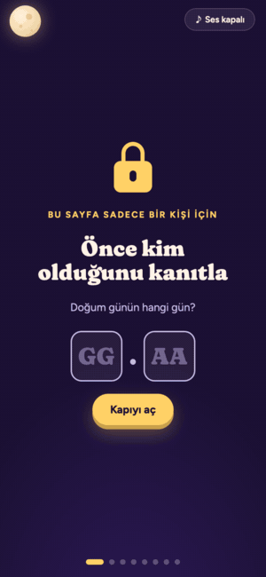
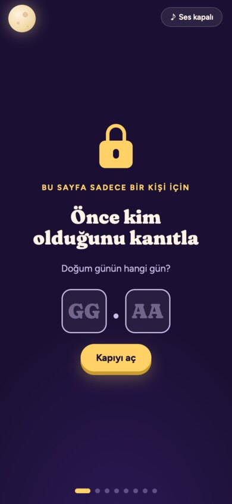
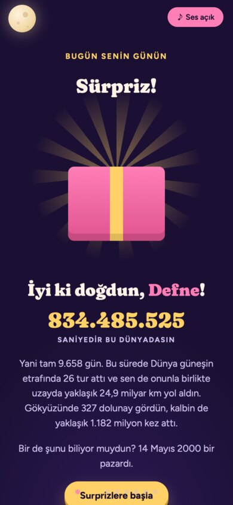
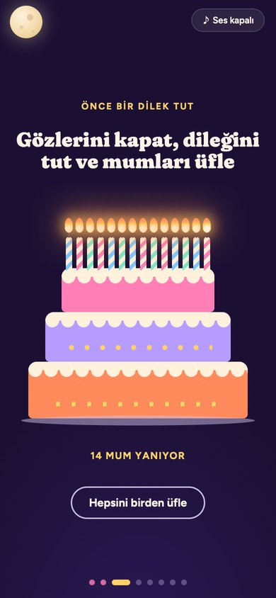
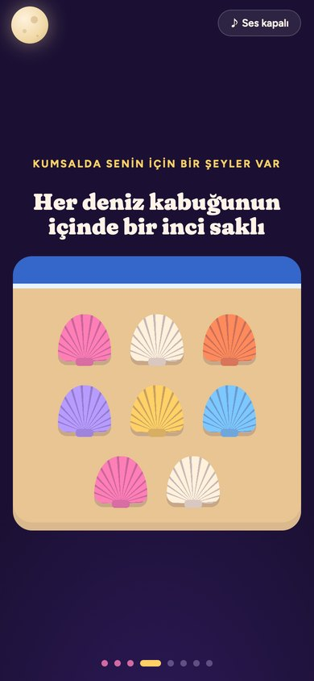
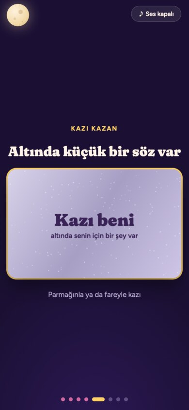
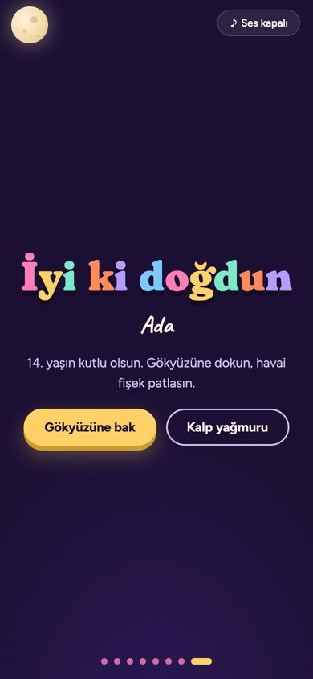
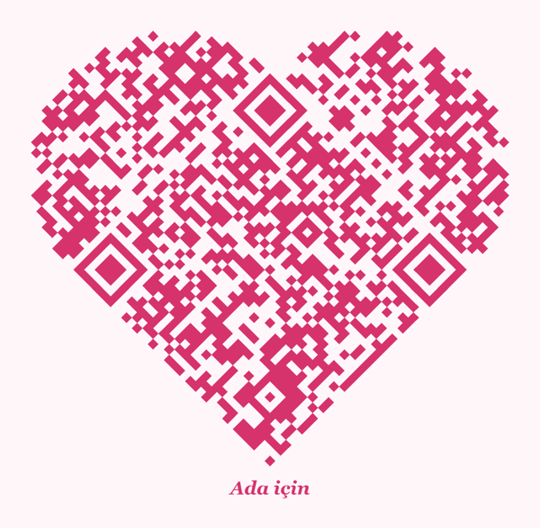

<a href="https://yigitbuyukeren.com/dogum-gunu/">
  <picture>
    <source media="(prefers-color-scheme: dark)" srcset="docs/banner-dark.jpg">
    
  </picture>
</a>

<div align="center">

**[🎉 Canlı demo](https://yigitbuyukeren.com/dogum-gunu/)** &nbsp;·&nbsp; **[✏️ Kendi sürümünü hazırla](#️-kişiselleştirme)** &nbsp;·&nbsp; **[💗 Kalp QR kod](#-kalp-şeklinde-qr-kod)**

[](LICENSE)


[](https://yigitbuyukeren.com/dogum-gunu/)

🇹🇷 [Türkçe](#-türkçe) &nbsp;·&nbsp; 🇬🇧 [English](#-english)

</div>

<p align="center"><a href="https://yigitbuyukeren.com/dogum-gunu/"></a></p>

<details open>
<summary><h2>🇹🇷 Türkçe</h2></summary>

Sevdiğin birine hazırlayabileceğin, animasyonlu ve interaktif bir doğum günü sayfası. **Tek bir HTML dosyası, kurulum gerektirmez.** Telefonda da bilgisayarda da çalışır.

> [!TIP]
> [Canlı demoyu](https://yigitbuyukeren.com/dogum-gunu/) aç. Girişteki "Doğum günün hangi gün?" sorusunun cevabı: **14 Şubat**.

### 📸 Sahneler

<table>
  <tr>
    <td align="center"><br><sub><b>🔒 Giriş kapısı</b><br>Doğum günü sorusu, ipuçlarıyla</sub></td>
    <td align="center"><br><sub><b>🎁 Hediye kutusu</b><br>Üç dokunuşta açılır, canlı sayaç çıkar</sub></td>
    <td align="center"><br><sub><b>🎂 Pasta</b><br>Yaşı kadar mum, sonra dilek feneri</sub></td>
  </tr>
  <tr>
    <td align="center"><br><sub><b>🐚 Deniz kabukları</b><br>Her birinde bir inci ve bir iltifat</sub></td>
    <td align="center"><br><sub><b>🎟️ Kazı kazan</b><br>Altından bir hediye kuponu</sub></td>
    <td align="center"><br><sub><b>🎆 Final</b><br>Havai fişek, yıldızlardan isim, gün doğumu</sub></td>
  </tr>
</table>

### 🎁 Neler var

Sayfa sekiz sahneden oluşuyor:

1. 🔒 **Giriş kapısı.** "Doğum günün hangi gün?" sorusu. Yanlış cevapta ipuçları doğum tarihinden kendiliğinden oluşur.
2. 🎁 **Hediye kutusu.** Üç dokunuşta açılır. Altından canlı bir sayaç çıkar: dünyada geçirilen saniyeler, Dünya'nın güneş etrafındaki tur sayısı, uzayda alınan yol, görülen dolunaylar ve doğulan günün hangi gün olduğu.
3. 🎂 **Pasta ve dilek feneri.** Yaşı kadar mum üflenir, sonra yazılan dilek bir fenerle gökyüzüne yükselir. Dilek hiçbir yere gönderilmez.
4. 🐚 **Deniz kabukları.** Her kabuğun altında bir inci ve bir iltifat var.
5. 🎟️ **Kazı kazan.** Altından bir hediye kuponu çıkar.
6. 🍾 **Şişedeki mesaj.** Dalgaların arasından gelen şişeden harf harf yazılan bir mektup çıkar.
7. 💌 **"Ne zaman ihtiyacın olursa aç" zarfları.** Dönen kartlarda destek veren kısa mesajlar.
8. 🎆 **Final.** Havai fişekler. "Gökyüzüne bak" denince yıldızlar birleşip adı yazar, ardından gün doğumu ve açan bir çiçek buketi gelir.

🌙 **Gizli bir sürpriz de var:** Sol üstteki aya beş kez dokununca doğduğu gecenin ay evresi gösterilir.

🎵 Müzik ve ses efektleri tarayıcıda üretilir (Web Audio), dışarıdan dosya yüklenmez.

### ✏️ Kişiselleştirme

Her şey `index.html` içindeki `CONFIG` nesnesinden ayarlanır:

| Alan | Ne işe yarar |
|---|---|
| `name` | Adı. Yıldızlar bu adı yazar (Türk alfabesinin bütün harfleri desteklenir). |
| `birth` | Doğum tarihi. Giriş sorusu, ipuçları, sayaç ve ay evresi buna göre hesaplanır. |
| `age`, `candles` | Boş bırakılırsa bu yılki yaş ve o kadar mum kullanılır. |
| `star` | Finalde gösterilen yıldız. Yaşına yakın uzaklıkta (ışık yılı) bir yıldız seçersen "doğduğun gün yola çıkan ışık şimdi ulaşıyor" mesajı anlamlı olur. |
| `reasons` | Deniz kabuklarından çıkan cümleler. |
| `coupon` | Kazı kazandan çıkan kupon. |
| `letter` | Mektup. `null` bırakılırsa örnek mektup kullanılır. |
| `openWhen` | "Ne zaman ihtiyacın olursa aç" zarfları. |
| `signature` | Mektubun imzası. |

💡 En güzel sonuç, mektuba ve kabuklara kendi cümlelerini yazınca çıkar.

### 🚀 Yayınlama

Dosyayı doğrudan tarayıcıda açabilirsin. Paylaşmak için GitHub Pages kullanabilirsin:

1. Bu depoyu kendi hesabına fork'la.
2. **Settings → Pages** bölümünde kaynak olarak `main` dalını seç.
3. Birkaç dakika sonra sayfan `https://kullanici-adin.github.io/dogum-gunu-surprizi/` adresinde yayında olur.

> [!WARNING]
> **Gizlilik:** Açık bir depoya gerçek isim, doğum tarihi ya da kişisel bir mektup koyarsan bunları herkes görebilir. Kişisel sürümünü gizli (private) bir depoda tut ya da başka bir yerde yayınla.

### 💗 Kalp şeklinde QR kod



`tools/kalp-qr.py` sitenin adresini kalp şeklinde bir QR koda dönüştürür. QR kod 45 derece döndürülür, iki üst kenarına yuvarlak "kulaklar" eklenir. En yüksek hata düzeltme seviyesi kullanıldığı için okunabilir kalır.

```bash
pip install qrcode pillow
python3 tools/kalp-qr.py https://site-adresin -o kalp-qr.png -t "Ada için"
```

🖨️ Basarken en az 5 cm genişlik ve açık renkli bir kağıt kullan. Yandaki örnek telefonla okutulabilir; canlı demoyu açar.

<br clear="right">

### 📜 Lisans

[MIT](LICENSE): kullanabilir, değiştirebilir, dağıtabilirsin. ⭐ Birini mutlu ettiyse yıldız vermeyi unutma!

</details>

<details>
<summary><h2>🇬🇧 English</h2></summary>

An animated, interactive birthday page you can prepare for someone you love. **A single HTML file, no install.** Works on phones and computers. The page itself is in Turkish.

> [!TIP]
> Open the [live demo](https://yigitbuyukeren.com/dogum-gunu/). The answer to the entry question ("When is your birthday?") is **14 February**.

**Eight scenes:** 🔒 an entry gate that builds hints from the birth date · 🎁 a gift box that opens after three taps and reveals a live counter (seconds alive, trips around the sun, distance travelled through space, full moons seen) · 🎂 candles to blow out and a wish lantern · 🐚 seashells hiding pearls and compliments · 🎟️ a scratch card with a gift coupon · 🍾 a message in a bottle typed letter by letter · 💌 "open when you need it" cards · 🎆 a finale with fireworks, the name written in the stars, a sunrise and a bouquet. 🌙 Tap the moon five times to see the moon phase on the night they were born.

**Make it yours:** everything lives in the `CONFIG` object in `index.html` (name, birth date, age, a star at the right distance in light years, compliments, coupon, letter, "open when" notes, signature). Music and sound effects are generated in the browser with Web Audio; nothing is loaded from outside.

**Share it:** fork the repository and turn on GitHub Pages, or host the file anywhere. Keep personal versions in a private repository. `tools/kalp-qr.py` turns the address into a heart-shaped QR code that still scans.

Released under the [MIT License](LICENSE).

</details>
